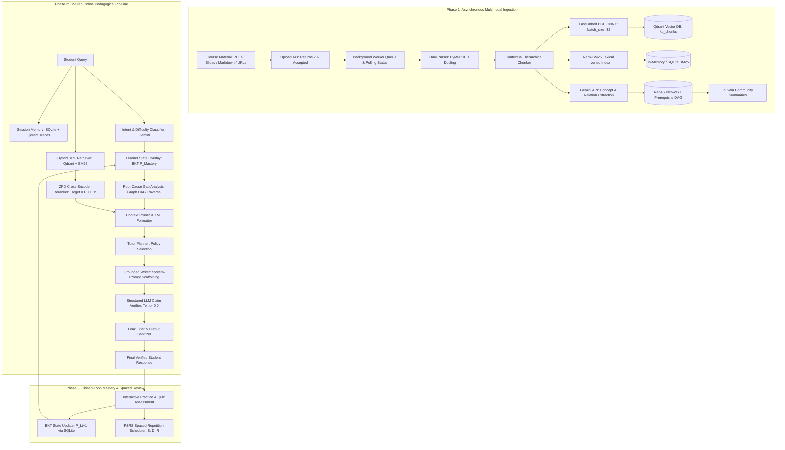

# AI Study Buddy: Learner-State-Aware RAG Platform

> An enterprise educational tutoring and retrieval-augmented generation (RAG) platform combining multimodal document ingestion, GraphRAG prerequisite tracking, hybrid vector/lexical retrieval, Bayesian Knowledge Tracing (BKT), and adaptive pedagogical planning.

📘 **For a complete catalog of all tools, libraries, databases, and runtimes used in this project, see [TOOLS.md](TOOLS.md).**

---

## 🛠️ System Architecture & Workflow

AI Study Buddy coordinates specialized AI models, vector stores, graph databases, and cognitive modeling engines across three unified workflows:



---

## 🔄 Detailed End-to-End Workflows

### 1. Ingestion Workflow (Asynchronous & Batched)
* **Non-Blocking Client Interaction**: When a user uploads a document or imports a URL via the dashboard, `POST /api/ingestion/upload` immediately returns `HTTP 202 Accepted` with a `job_id`.
* **Background Worker Queue**: Heavy parsing and embedding computation run in an asynchronous background worker task (`_run_background_indexing`).
* **Live Progress Polling**: The frontend polls `GET /api/ingestion/status/{job_id}` every 750ms, rendering real-time progress percentages (`10%`, `30%`, `55%`, `80%`, `100%`) and stage descriptions (`Parsing pages`, `Generating embeddings`, `Indexing concept graph`).
* **Dual Parsing Engine**: **PyMuPDF (`fitz`)** rasterizes high-resolution page previews (`pages/*.png`) while **Docling** extracts structural tables and layout blocks.
* **Concurrent Execution**:
  * Dense vectors are computed in parallel batches (`batch_size=32`) using **FastEmbed** (`BAAI/bge-small-en-v1.5`).
  * Concept entities, prerequisite relations (`PREREQUISITE_FOR`), and common misconceptions are extracted concurrently via **Google Gemini** using `asyncio.gather`.
* **Atomic Storage**: Chunks and embeddings are indexed into **Qdrant** (`kb_chunks`), **Rank-BM25**, and the **Neo4j / NetworkX** Knowledge Graph DAG.

---

### 2. Online Pedagogical Tutoring Pipeline (12 Steps)

Every student query traverses a deterministic, quality-controlled pipeline:

| Step | Engine / Tool | Description |
| :--- | :--- | :--- |
| **1. Memory Lookup** | SQLite + Qdrant | Retrieves recent turns from session memory and searches `learner_traces` for past struggles. |
| **2. Intent Analysis** | Google Gemini | Classifies student intent, target concepts, and question difficulty. |
| **3. Learner Overlay** | Bayesian Knowledge Tracing (BKT) | Looks up the student's current concept mastery probability $P(L_t) \in [0.0, 1.0]$. |
| **4. Root-Cause Gap Analysis** | Neo4j / NetworkX DAG Traversal | Traverses prerequisite dependencies backwards to locate unmastered foundational prerequisites ($P < 0.45$). |
| **5. Hybrid Retrieval** | Qdrant + Rank-BM25 (RRF) | Executes parallel dense vector and sparse keyword search, fusing ranks via Reciprocal Rank Fusion ($k=60$). |
| **6. ZPD Neural Reranking** | BGE-Reranker Cross-Encoder | Re-scores candidates calibrated to the student's Zone of Proximal Development: $\text{Target} = P(L_t) + 0.15$. |
| **7. Context Pruning** | ContextBuilder | Cleanses overlapping text between chunk boundaries and community summaries, strictly capping context under 2,500 tokens. |
| **8. Tutor Planner** | Deterministic Cognitive Policy | Selects the optimal pedagogical action (`EXPLAIN`, `SOCRATIC`, `HINT`, `REMEDIATE`, `WORKED_EXAMPLE`, or `QUIZ`). |
| **9. Grounded Generation** | Gemini + System Prompt Pedagogy | Wraps evidence in `<source id="REF-X" doc="..." page="...">` XML tags; dynamic scaffolding rules are embedded in the System Prompt. |
| **10. Structured Claim Verification** | Gemini Structured Output (`Temp=0.0`) | Extracts atomic factual claims and verifies entailment against XML sources, eliminating false-positive CPU NLI flags. |
| **11. Leak & Guardrail Filter** | Regex + Policy Sanitizer | Protects system instructions and scrubs unintended metadata. |
| **12. Observability & Telemetry** | Langfuse Telemetry Manager | Logs latency, token metrics, and faithfulness scores with zero overhead. |

---

### 3. Closed-Loop Mastery & Spaced Review Workflow
* **Targeted Practice**: Generates diagnostic multiple-choice and open-ended questions based on concepts with emerging mastery.
* **BKT State Transitions**: When the student answers an assessment problem, BKT dynamically updates concept mastery:
  $$P(L_{t+1}) = P(L_t \mid \text{Evidence}) + (1 - P(L_t \mid \text{Evidence})) \cdot P(T)$$
  accounting for slip $P(S)$ and guess $P(G)$ probabilities.
* **FSRS Spaced Repetition**: Calculates memory Stability ($S$), Difficulty ($D$), and Retrievability ($R$), scheduling flashcard reviews at the optimal forgetting curve threshold.

---

## 🧩 Tool Combination Matrix

| Category | Primary Tools | Operational Interconnection in System |
| :--- | :--- | :--- |
| **Brain & LLM** | Google Gemini (`gemini-2.5-flash` / `gemini-3.8-flash`) | Intent parsing, concept extraction, citation-grounded tutoring, and claim verification. |
| **Vector DB** | Qdrant (`v1.8.4`) | Stores dense BGE ONNX embeddings for fast cosine similarity and episodic trace retrieval. |
| **Lexical Engine** | Rank-BM25 | Handles exact acronym, formula, and keyword matching. Fused with Qdrant via RRF ($k=60$). |
| **Graph DB & DAG** | Neo4j (`5.20`) + NetworkX (Fallback) | Models conceptual curriculum hierarchy (`PREREQUISITE_FOR`) and diagnoses upstream student learning blockers. |
| **Relational DB** | SQLite (`aiosqlite`) | Stores documents, pages, chat turns, and BKT student mastery state. |
| **Ingestion** | PyMuPDF (`fitz`) + Docling + Trafilatura | Converts multi-format inputs (PDF, DOCX, PPTX, Web URLs, Images) into structured pages and chunk corpora. |
| **Embeddings** | FastEmbed (`BAAI/bge-small-en-v1.5`) | Batched local ONNX embedding inference (`batch_size=32`) on standard CPU without GPU requirements. |
| **Cognitive Policy** | BKT + FSRS + Vygotskian ZPD | Adapts explanation tone and schedules reviews based on quantitative learner mastery models. |
| **Frontend SPA** | React 18 + Vite + Lucide React | Unified interactive interface: live chat, interactive concept canvas, page inspection, and study tools. |
| **Deployment** | Docker Compose + Nginx | Lightweight containerized stack orchestrating Frontend (3000), Backend (8000), and Qdrant (6333/6334). |

---

## 🚀 Quick Start (Lightweight Docker Setup)

The platform is optimized for fast, lightweight local deployment:

### 1. Configure Secrets
```bash
# Copy template and add your Google Gemini API Key
cp .env.example .env
```
Ensure `.env` contains:
```ini
GEMINI_API_KEY="your_google_gemini_api_key_here"
GEMINI_MODEL="gemini-2.5-flash"
```

### 2. Launch Services
```bash
docker compose up -d
```

### 3. Access Endpoints
- **Student Web Application**: [http://localhost:3000](http://localhost:3000)
- **FastAPI Backend & Interactive API Docs**: [http://localhost:8000/docs](http://localhost:8000/docs)
- **Qdrant Vector Dashboard**: [http://localhost:6333/dashboard](http://localhost:6333/dashboard)

---

## 🧪 Automated Testing

Execute the automated test suites locally:

```bash
# Run backend unit tests and pipeline validation
pytest backend/tests/test_unit_core.py backend/tests/test_pipeline.py -v

# Run enhanced ingestion and RRF retrieval verification
python backend/tests/verify_enhanced_ingestion.py
```